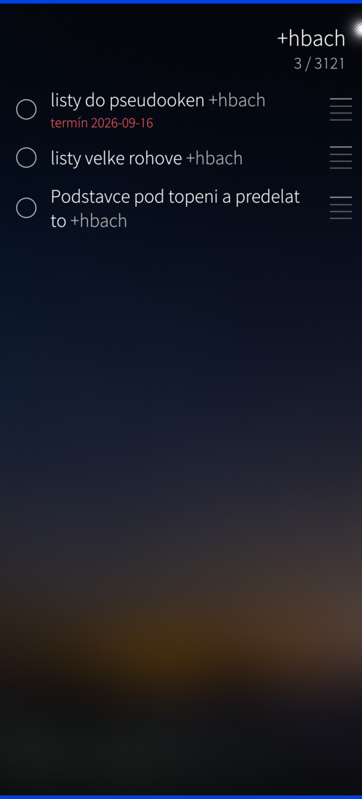
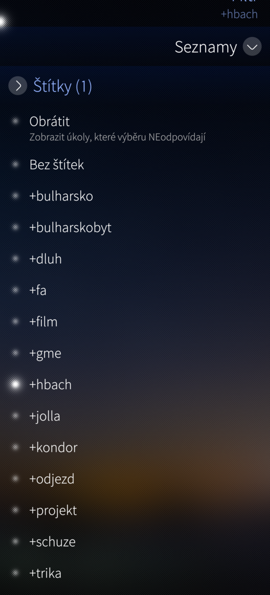

# Todo.txt (harbour-todotxt)

A [todo.txt](http://todotxt.org/) task manager for Sailfish OS 5.x (Jolla),
ported from [Simpletask](https://github.com/mpcjanssen/simpletask-android)
(Android). The plain text file stays the single source of truth: the app reads
and writes `todo.txt` (and `done.txt` next to it) and can be combined with any
sync tool that moves the file.

Version 1.0.0 (see `rpm/harbour-todotxt.spec`). UI languages: English, Czech,
German, French, Spanish, Italian, Russian, Polish, Dutch, Swedish, Finnish.

## Screenshots

| Task list (filtered by a project) | Filter page (projects, inverted selection) |
|---|---|
|  |  |

---

## 1. Features

- **todo.txt format**, lossless: every token of a line is kept (`(A)` priority,
  `x` completion with dates, creation date, `@context`, `+project`, `due:`,
  `t:` threshold, `rec:` recurrence, `h:1` hidden, `key:value` tags, links).
- **Task list** grouped by the first sort key, with due/threshold dates on a
  separate line (optional), coloured dates (overdue, today), uppercase headers
  (optional). Cover shows the counts of overdue and due-today tasks.
- **Calendar**: the date icon in the header opens a month view of the due dates
  of the tasks in the current filter, colour-coded like the list (overdue red,
  today green, tomorrow blue, the day after tomorrow dark blue, later yellow).
  Tap a day to jump to the first task due that day. The shown month/year is
  remembered; the **Today** button resets it to the current month.
- **Add / edit** with a text editor, quick insertion of priority, contexts,
  projects, due and threshold dates. New tasks get a creation date and a
  capital first letter (both optional).
- **Complete / uncomplete**, with recurrence (`rec:Nd|w|m|y`, `rec:+N...` strict
  from the due date) creating the next task.
- **Multi-selection**: complete, delete, change priority, add/remove contexts and
  projects, defer due or threshold dates (today, tomorrow, +1 week, +2 weeks,
  +1 month, pick a date).
- **Filter page** (attached to the right of the list): contexts, projects,
  priorities, each with inversion ("NOT matching"), show completed / future /
  hidden, free-text search.
- **Sort order** with multiple keys: completed last, future last, priority,
  context, project, due date, threshold date, creation date, completion date,
  alphabetical, **manual order**. Tap a key to flip its direction, long press
  to move it.
- **Manual order** is stored in the file as a `#N` token at the end of the line
  (this port's extension, N in steps of 1024), so it survives sync. Dragging a
  task is allowed only when the result stays sorted by the keys above "manual";
  only the tie group is renumbered. `#N` is removed from completed tasks and
  whenever no sort order needs it.
- **Saved filters**: save the current filter + sort order under a name, rename,
  update, delete, switch from the pulley.
- **Archive**: move completed tasks to `done.txt`, manually or automatically
  right after completing.
- **File handling**: configurable file path (file picker), the file is watched
  and reloaded when changed externally; writes are delayed by a configurable
  idle time (default 3 s) and coalesced; optional CRLF line breaks.
- **Settings** for all of the above plus todo.txt terminology
  (context/project vs. list/tag) and case sensitive sorting.

---

## 2. File locations

| What | Where |
|---|---|
| Tasks | `~/Documents/todotxt/todo.txt` (default, configurable) |
| Archive | `done.txt` next to the todo file |
| Settings and saved filters | `~/.config/cz.mig/harbour-todotxt/harbour-todotxt.conf` |

The Sailjail permission `Documents` is required for the default location;
`UserDirs` lets the picker reach the other user folders.

---

## 3. Structure

```
harbour-todotxt.pro            qmake project (sailfishapp, sailfishapp_i18n)
harbour-todotxt.desktop        launcher + Sailjail permissions (Documents;UserDirs)
rpm/harbour-todotxt.spec       RPM spec (aarch64 / armv7hl / i486)
icons/gen.py                   launcher icon generator (PIL)
src/task.{h,cpp}               Task: lossless tokenizer, accessors, completion,
                               recurrence (port of Simpletask's Task.kt)
src/todostore.{h,cpp}          TodoStore: file load/save, watcher, archive, #N order
src/query.{h,cpp}              Query: filter + sort state, matching, comparators
src/taskmodel.{h,cpp}          TaskModel: QAbstractListModel over the store through
                               the query, selection, headers, manual move
src/filterstore.{h,cpp}        FilterStore: saved filters (JSON in settings)
src/settings.{h,cpp}           Settings: QSettings-backed properties
src/harbour-todotxt.cpp        main: context properties, QML view
qml/harbour-todotxt.qml        ApplicationWindow, helpers (terms, dialogs)
qml/pages/MainPage.qml         task list, pulley, selection mode, search
qml/pages/CalendarPage.qml     month view of due dates, jump to a day
qml/pages/FilterPage.qml       attached filter page
qml/pages/ItemsPage.qml        pick contexts / projects for the selection
qml/pages/PriorityPage.qml     pick a priority
qml/pages/DeferPage.qml        defer due / threshold dates
qml/pages/SortPage.qml         sort keys (flip, move)
qml/pages/SavedFiltersPage.qml saved filters
qml/pages/NameDialog.qml       name entry for saved filters
qml/pages/TaskDialog.qml       add / edit task
qml/pages/FilePickerPage.qml   choose the todo file
qml/pages/SettingsPage.qml     settings
qml/components/TaskDelegate.qml list delegate
qml/cover/CoverPage.qml        cover with overdue / today counts
translations/                  harbour-todotxt.ts (source) + per-language .ts
tools/gen_ts.py                generates the per-language .ts files from tables
tools/deploy.sh                build with sfdk and install on a phone over SSH
tests/                         unit tests of Task (qmake, QtTest)
docs/                          screenshots for this README
```

### Translations

`CONFIG += sailfishapp_i18n` runs `lupdate` and `lrelease` during the build;
the `.qm` files are installed to `/usr/share/harbour-todotxt/translations` and
loaded by the system locale. After adding a string:

```
sfdk build-shell lupdate -noobsolete src qml -ts translations/harbour-todotxt.ts
python3 tools/gen_ts.py translations/harbour-todotxt.ts     # prints MISSING entries
```

The translations themselves live in the tables inside `tools/gen_ts.py`
(plural forms included: 3 for cs/ru/pl, 2 for the others).

---

## 4. Known limitations

- No Lua scripting (Simpletask's Lua filters are not ported).
- No cloud sync of its own; use an external sync of the todo file.
- Manual ordering (`#N`) is an extension of this port; other todo.txt clients
  will show the token as plain text.

---

## 5. Build and deployment

Sailfish SDK:

```
sfdk -c target=SailfishOS-5.1.0.11-aarch64 build       # -> RPMS/
```

`tools/deploy.sh` builds and installs the RPM on a phone reachable over SSH
(developer mode); set `PHONE`, `PORT` and `KEY` for your setup.

Unit tests (host or build engine):

```
cd tests && qmake && make && ./tst_task
```

---

## 6. Licence

GPLv3, following Simpletask. Simpletask is (c) Mark Janssen and contributors.

## Privacy

All data stays on the device. The app reads and writes `todo.txt` and
`done.txt` in the folder you choose (`~/Documents/todotxt/` by default) and
keeps its settings locally. It does not connect to the network and sends
nothing anywhere.
