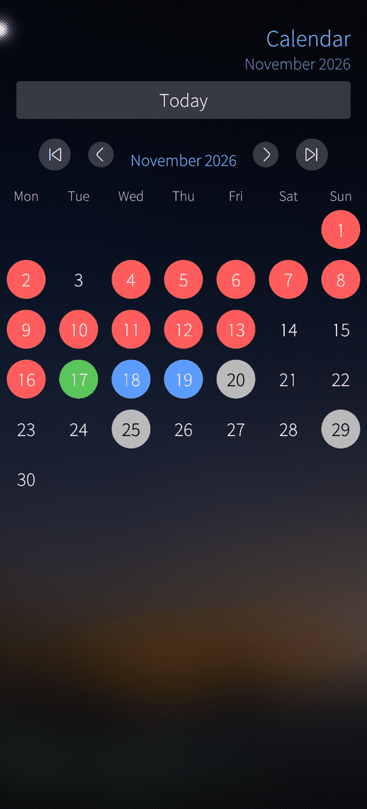
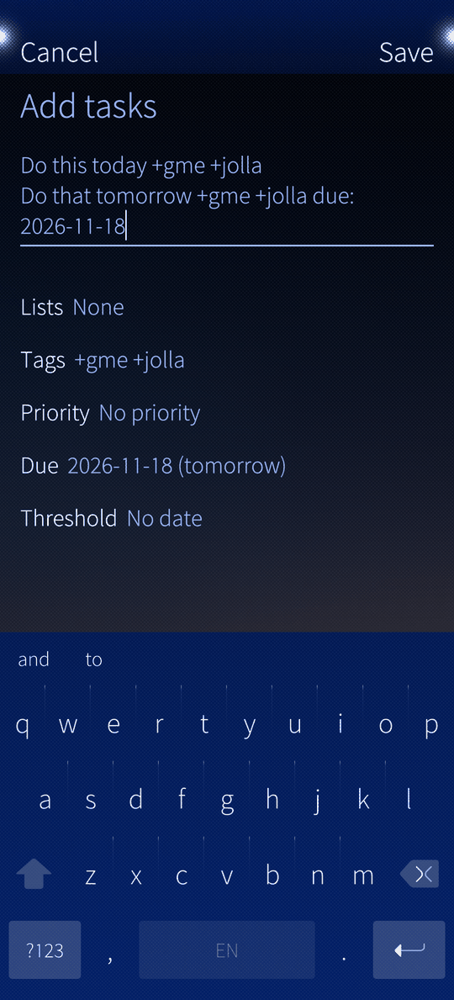
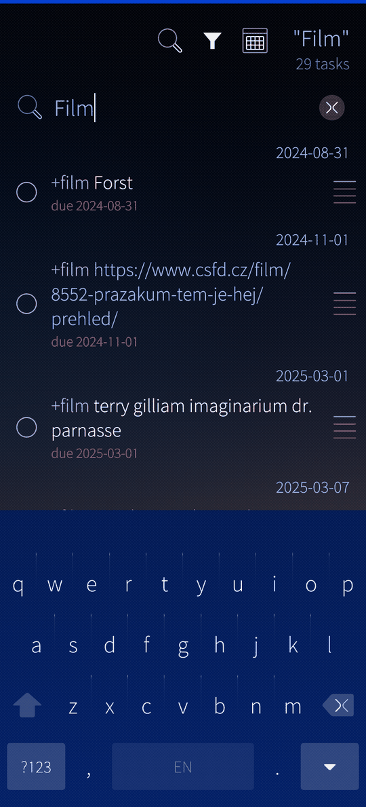
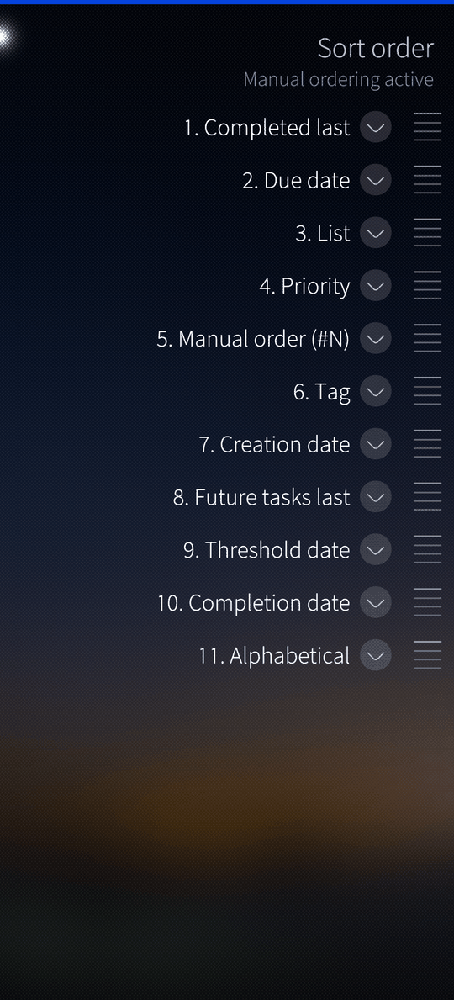

# Todo.txt (harbour-todotxt)

A [todo.txt](http://todotxt.org/) task manager for Sailfish OS 5.x (Jolla),
ported from [Simpletask](https://github.com/mpcjanssen/simpletask-android)
(Android). The plain text file stays the single source of truth: the app reads
and writes `todo.txt` (and `done.txt` next to it) and can be combined with any
sync tool that moves the file.

**The best todo app for Sailfish OS — inspired by Simpletask, ADHD friendly and
built to keep form-filling to a minimum.**

Version 1.7.3 (see `rpm/harbour-todotxt.spec`). UI languages: English, Czech,
German, French, Spanish, Italian, Russian, Polish, Dutch, Swedish, Finnish.

## Screenshots

| Task list (grouped by due date) | Calendar | Add tasks (multi-line) |
|---|---|---|
|  |  |  |

| Search (from the header icon) | Filter page | Sort order |
|---|---|---|
|  |  |  |

---

## 1. Features

- **todo.txt format**, lossless: every token of a line is kept (`(A)` priority,
  `x` completion with dates, creation date, `@context`, `+project`, `due:`,
  `t:` threshold, `rec:` recurrence, `done:` occurrence markers, `h:1` hidden,
  `key:value` tags, links).
- **Task list** grouped by the first sort key, with due/threshold dates on a
  separate line (optional), coloured dates (overdue red, today green, soon
  blue), uppercase headers (optional). The header shows the number of
  *not-completed* tasks and has icon buttons for search, the filter and the
  calendar. Cover shows the counts of overdue and due-today tasks.
- **Task long-press**: enters multi-selection with the pressed task selected
  (no context menu). Complete/uncomplete is done with the checkbox next to the
  task (or from multi-selection).
- **Calendar**: the date icon in the header opens a month view of the due dates
  of the tasks in the current filter, colour-coded (overdue red, today green,
  tomorrow and the day after blue, later grey); a day with a threshold is
  yellow and today is always green. Tap a day to jump to the first task due or
  starting that day. The shown month/year is remembered; **Today** resets it.
- **Add / edit** with a text editor. The editor is multi-line: press Enter to
  start the next task, prefilled with the current line's priority, contexts,
  projects, due and threshold dates. This works while editing as well, so new
  tasks can be created in the same go (lines added below the edited tasks become
  new tasks; a prefilled line left without text is dropped). Each list/tag/priority
  row shows an inline swipeable strip of the most used items still missing on the
  line (up to 12, counted over tasks dated within the last 60 days and filled up
  with overall usage); it stays while there is anything left to add. Tapping a chip
  adds it, while tapping the row itself opens the full picker. Quick insertion of priority,
  contexts, projects, due, threshold and recurrence (the rows) applies to the
  line under the cursor; the buttons in the **Quick choice** section set the due
  date to today/tomorrow and save. Links, phone numbers and e-mail addresses
  found in the text of the edited task can be opened/called/mailed from the form.
- **Date picker** (Due / Threshold): the month calendar is shown inline (the same
  look as the jump calendar) with the presets below it (today, tomorrow, the day
  after tomorrow, in a week, in two weeks, in a month, no date / no threshold).
- **Dates** are shown as a weekday and the date in the list, section headers and
  the editor (e.g. `st 2026-11-18`); a threshold is prefixed with `≤` and shown
  as a yellow chip (and a yellow day in the calendar).
- **Complete / uncomplete** with the checkbox or from multi-selection.
- **Recurring tasks** (`rec:[+]<n><unit>`, units `d`/`b`/`w`/`m`/`y`): anchored on
  the `due:` date (or on the creation date when there is no due date) and shown
  as a series of occurrences around today — up to a number of occurrences before
  and after today set in Settings (default 5; 0 shows only the task itself).
  Each occurrence is
  a normal row with its own checkbox; ticking it stores a `done:YYYY-MM-DD`
  marker on the task (un-ticking removes it) instead of completing the task, so
  it stays clear which occurrences are done (struck through) and which are still
  pending or overdue. A recurring task needs a due date or a creation date —
  otherwise the editor warns and saving is blocked. Recurrence is edited from a
  **Recurrence** row in the task editor: preset buttons (the active one
  highlighted) plus a custom count / unit / strict-`+` editor (`+` counts the
  next date from the due date, otherwise from the completion date).
- **Multi-selection**: complete, delete, change priority, add/remove contexts and
  projects, defer due or threshold dates (presets or the calendar).
- **Filter page** (opened from the filter icon in the header; the sections start
  collapsed and the expanded one is remembered): contexts, projects, priorities,
  each with inversion ("NOT matching"), show completed / future / hidden.
- **Search** from the magnifier icon in the header: a search field opens under
  the title and closes again when emptied. A swipe left on the list opens the
  new task dialog.
- **Sort order** with multiple keys: completed last, future last, priority,
  context, project, due date, threshold date, creation date, completion date,
  alphabetical, **manual order**. Tap a key to flip its direction, long press
  to move it.
- **Manual order** is stored in the file as a `#N` token at the end of the line
  (this port's extension, N in steps of 1024), so it survives sync. The drag
  handle on the right reorders a task within its sort group (only the tie group
  is renumbered) and auto-scrolls when dragged past a list edge. Dragging a task
  into another due-date group changes its due date (or clears it for "no date")
  and drops it at the target position. `#N` is removed from completed tasks and
  whenever no sort order needs it.
- **Saved filters**: save the current filter + sort order under a name; they are
  listed on the Filter page below the filter sections and can be applied with a
  tap, or updated / renamed / deleted with a long press.
- **Archive**: move completed tasks to `done.txt`, on demand from the pulley
  (pull down; archives *every* completed task) or automatically right after
  completing.
- **File handling**: you pick the *folder* that holds `todo.txt` and `done.txt`
  (folder picker; on the first run the app offers to choose one), the file is
  watched and reloaded when changed externally; writes are delayed by a
  configurable idle time (default 3 s) and coalesced; optional CRLF line breaks.
- **Settings** for all of the above plus todo.txt terminology
  (context/project vs. list/tag) and case sensitive sorting.

---

## 2. File locations

| What | Where |
|---|---|
| Folder (chosen in Settings) | `~/Documents/todotxt/` by default |
| Tasks | `todo.txt` in that folder |
| Archive | `done.txt` in that folder |
| Settings and saved filters | `~/.config/cz.mig/harbour-todotxt/harbour-todotxt.conf` |

The Sailjail permission `Documents` is required for the default location;
`UserDirs` lets the picker reach the other user folders.

On first start, if no folder has been chosen yet, the app creates a small
example `todo.txt` (tasks overdue, due today, tomorrow, the day after tomorrow
and in a week, plus one completed) and a `done.txt` in `~/Documents/todotxt/`,
so it opens with a usable list. A hint over the list says it is an example and
points to Settings; it disappears when tapped or once another folder is picked.
No existing files are ever overwritten.

---

## 3. Structure

```
harbour-todotxt.pro            qmake project (sailfishapp, sailfishapp_i18n)
harbour-todotxt.desktop        launcher + Sailjail permissions (Documents;UserDirs)
rpm/harbour-todotxt.spec       RPM spec (aarch64 / armv7hl / i486)
icons/gen.py                   launcher icon generator (PIL)
src/task.{h,cpp}               Task: lossless tokenizer, accessors, completion,
                               recurrence (port of Simpletask's Task.kt)
src/todostore.{h,cpp}          TodoStore: file load/save, watcher, archive, #N order
src/query.{h,cpp}              Query: filter + sort state, matching, comparators
src/taskmodel.{h,cpp}          TaskModel: QAbstractListModel over the store through
                               the query, selection, headers, manual move
src/filterstore.{h,cpp}        FilterStore: saved filters (JSON in settings)
src/settings.{h,cpp}           Settings: QSettings-backed properties (todo/done
                               folder, derived todo.txt/done.txt paths)
src/harbour-todotxt.cpp        main: context properties, QML view
qml/harbour-todotxt.qml        ApplicationWindow, helpers (terms, dialogs)
qml/pages/MainPage.qml         task list, pulley, selection mode, search
qml/pages/CalendarPage.qml     month view of due dates, jump to a day
qml/pages/FilterPage.qml       attached filter page
qml/pages/ItemsPage.qml        pick contexts / projects for the selection
qml/pages/PriorityPage.qml     pick a priority
qml/pages/DeferPage.qml        defer due / threshold dates
qml/pages/SortPage.qml         sort keys (flip, move)
qml/pages/SavedFiltersPage.qml saved filters
qml/pages/NameDialog.qml       name entry for saved filters
qml/pages/TaskDialog.qml       add / edit task
qml/pages/PickFolderPage.qml   choose the folder with todo.txt (and done.txt)
qml/pages/SettingsPage.qml     settings
qml/components/TaskDelegate.qml list delegate (completion mark, drag handle)
qml/symbols/icon-m-filter.svg  filter icon used in the header
qml/cover/CoverPage.qml        cover with overdue / today counts
translations/                  harbour-todotxt.ts (source) + per-language .ts
tools/gen_ts.py                generates the per-language .ts files from tables
tools/deploy.sh                build with sfdk and install on a phone over SSH
tests/                         unit tests of Task (qmake, QtTest)
docs/                          screenshots for this README
```

### Translations

`CONFIG += sailfishapp_i18n` runs `lupdate` and `lrelease` during the build;
the `.qm` files are installed to `/usr/share/harbour-todotxt/translations` and
loaded by the system locale. After adding a string:

```
sfdk build-shell lupdate -noobsolete src qml -ts translations/harbour-todotxt.ts
python3 tools/gen_ts.py translations/harbour-todotxt.ts     # prints MISSING entries
```

The translations themselves live in the tables inside `tools/gen_ts.py`
(plural forms included: 3 for cs/ru/pl, 2 for the others).

---

## 4. Known limitations

- No Lua scripting (Simpletask's Lua filters are not ported).
- No cloud sync of its own; use an external sync of the todo file.
- Manual ordering (`#N`) is an extension of this port; other todo.txt clients
  will show the token as plain text.

---

## 5. Build and deployment

Sailfish SDK:

```
sfdk -c target=SailfishOS-5.1.0.11-aarch64 build       # -> RPMS/
```

`tools/deploy.sh` builds and installs the RPM on a phone reachable over SSH
(developer mode); set `PHONE`, `PORT` and `KEY` for your setup.

Unit tests (host or build engine):

```
cd tests && qmake && make && ./tst_task
```

---

## 6. Licence

GPLv3, following Simpletask. Simpletask is (c) Mark Janssen and contributors.

## Privacy

All data stays on the device. The app reads and writes `todo.txt` and
`done.txt` in the folder you choose (`~/Documents/todotxt/` by default) and
keeps its settings locally. It does not connect to the network and sends
nothing anywhere.
